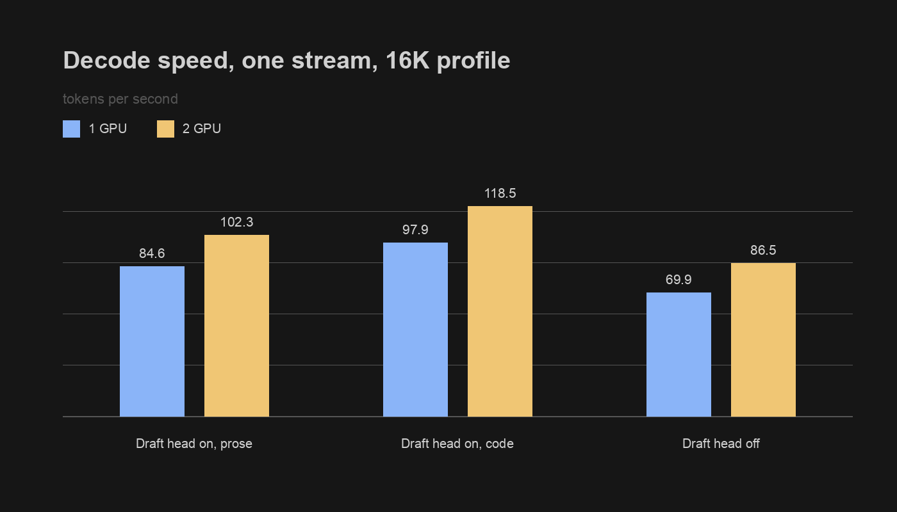
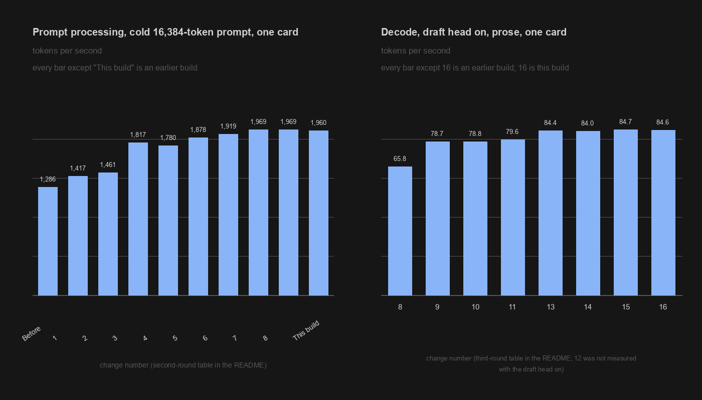

# Inkling 2 Mini on Radeon AI PRO R9700, one card or two

[Inkling 2 Mini](https://huggingface.co/thinkingmachines/Inkling-2-Mini) from Thinking Machines, served natively on AMD `gfx1201` cards with the [Radiance](https://codeberg.org/StillDeadcode/radiance) inference engine. The model card lists a DGX Spark and Apple silicon, then says "other GPUs and platforms are possible". This folder is one way to make that true for the R9700: a patch against a pinned Radiance commit, a build script, a convert script, and a launch script with a serve profile for one card (`1gpu/`) and for two (`2gpu/`).

The server speaks the OpenAI chat API on localhost. Text, images and tool calls work. The checkpoint's own draft head runs as the speculative decoder, three drafted tokens a step. The KV cache is int8.

## Numbers

One request at a time, server-side timings, 210 W power cap on each card. Measured on a fine-tune of the model, not the stock download (named in the first note under the table). Every figure in the Numbers table and the two change tables is in [`results/numbers.json`](results/numbers.json).

| | 1 GPU | 2 GPU |
|---|---:|---:|
| Decode, draft head on, prose (tok/s) | 84.6 | 102.3 |
| Decode, draft head on, code (tok/s) | 97.9 | 118.5 |
| Decode, draft head off (tok/s) | 69.9 | 86.5 |
| Prompt processing, cold 16,384-token prompt (tok/s) | 1,960 | not measured |
| Time to first token, cold 72,644-token prompt (s) | 66.1 | not measured |



How to read these:

- These runs used [`OpenUncensored/Inkling-2-Mini-Uncensored`](https://huggingface.co/OpenUncensored/Inkling-2-Mini-Uncensored) at revision `748f78ee942acf376d4e11eac92f6c3034c84ddb`, a fine-tune of Inkling 2 Mini with the release's exact architecture, not the stock download. `convert.sh` was also run on the stock download and completes, but no figure here was measured on it.
- These are engine speed figures. Draft-off decode and prompt processing do not depend on the values of the weights, so they hold for any checkpoint of this architecture. Draft-on decode also depends on how often the draft is accepted, which moves with the checkpoint and with what is being written.
- Decode rows are six 300-token chat completions at temperature 0 on the 16K profile: one prose prompt and one code prompt, three runs each. The table shows the median of each three. The draft-off figure is the prose median (the code median is 69.7 on one card and 86.3 on two).
- Code is easier to draft than prose, which is why the draft-on rows differ and the draft-off row does not.
- "Cold" means nothing cached. The 16K row uses 2,048-token prefill chunks and the 72,644-token row uses 512-token chunks. Both prompt rows were measured with their own profiles, which are not in this folder: the shipped 16K profiles use 128-token chunks, and the long profile has not been run on this build.
- One stream only. Nothing here says anything about batch throughput.
- The second card adds 21% to 24%, not 100%. Each card holds half the attention heads and half the experts, and the two exchange results inside every layer.

No quality evaluation is published here. Run your own before you rely on it.

## What you need

- One or two Radeon AI PRO R9700 (32 GB, `gfx1201`). The weights take about 16 GiB of VRAM on one card; the token embedding stays in host memory.
- Linux with the `amdgpu` driver exposing `/dev/kfd` and the cards' render nodes. Built and run on Ubuntu 24.04.5, kernel 7.0.0.
- Docker and the image `rocm/dev-ubuntu-24.04:10.1.0-full`. Everything builds and runs inside it; nothing from ROCm is installed on the host.
- git, about 120 GB of free disk for the checkpoint, the intermediate files and both packs, and 24 GB of host RAM for the containers.

## Build

```sh
./build.sh
```

This clones Radiance at commit `689f554596d668c24efcf60f0ea74e47c7b01338`, applies [`patches/radiance-inkling2-gfx1201.patch`](patches/radiance-inkling2-gfx1201.patch), compiles for `gfx1201` inside the ROCm container (about five minutes here) and leaves a self-contained `runtime/` next to the script: the server, the converter, the kernel libraries, and the shared libraries the stock image lacks.

## Convert the checkpoint

Download the model, then convert it once:

```sh
hf download thinkingmachines/Inkling-2-Mini --local-dir /path/to/Inkling-2-Mini

CHECKPOINT=/path/to/Inkling-2-Mini PACKS=/path/to/packs GPU_PCI=0000:xx:00.0 ./convert.sh 1gpu
CHECKPOINT=/path/to/Inkling-2-Mini PACKS=/path/to/packs GPU_PCI=0000:xx:00.0 ./convert.sh 2gpu   # only for two cards
```

`GPU_PCI` is the PCI address of a card (`lspci -D | grep -i -e radeon -e display`). The `0000:xx:00.0` and `0000:yy:00.0` in the examples are placeholders for your own cards' addresses. The first command took two minutes here and writes `inkling-2-mini-1gpu.rad` (18.2 GB). The second copies that pack and rewrites 24 weights as 48, which took 13 seconds and writes `inkling-2-mini-2gpu.rad` (18.9 GB). `PACKS/prepared` holds about 55 GB of intermediate files and can be deleted afterwards.

To reproduce the figures above, download the fine-tune named under Numbers, at that revision, instead; the two `convert.sh` commands are the same. Both were run exactly as written on that download with this build, and each pack they made was served with its launch script and default profile: the two-card pack returned 88 of 88 reference token IDs on two cards, and the one-card pack 88 of 88 on one. A pack made from the stock download has not been served.

What the conversion does to the weights: the checkpoint's packed NVFP4 and MXFP8 experts are expanded to BF16 with the same rounding Transformers uses, then the routed experts are requantized to signed 4-bit codes with one BF16 scale per 128 inputs. Dense weights stay BF16, norms and routing weights are F32, and expert activations are quantized to FP8 at run time. That is a different 4-bit format from the one the checkpoint ships in, chosen because the engine has kernels for it.

The one-card and two-card packs hold the same weights. They differ in one thing: the one-card build reads each attention layer's query and gate projections as a single concatenated weight, and two cards split those projections by head and need them stored apart.

## Run

One card:

```sh
PACK=/path/to/packs/inkling-2-mini-1gpu.rad GPU_PCI=0000:xx:00.0 1gpu/launch.sh
```

Two cards:

```sh
PACK=/path/to/packs/inkling-2-mini-2gpu.rad GPU_PCI_0=0000:xx:00.0 GPU_PCI_1=0000:yy:00.0 2gpu/launch.sh
```

Then, from another shell:

```sh
curl -s http://127.0.0.1:8080/v1/chat/completions -H 'Content-Type: application/json' -d '{
  "model": "inkling-2-mini",
  "messages": [{"role": "user", "content": "Name a primary color."}],
  "max_tokens": 512
}'
```

The model reasons before it answers, and reasoning tokens count against `max_tokens`.

| Profile | Context | Prefill chunk | Draft head |
|---|---:|---:|---|
| `1gpu/serve.yaml`, `2gpu/serve.yaml` (defaults) | 16,384 | 128 | on, window 3 |
| `1gpu/serve-long.yaml` | 212,992 | 2,048 | on, window 3 |

Pass a profile as the first argument to `launch.sh`. The decode rows above come from the 16K profiles.

The launch scripts set two environment variables the kernels read. `R4D_INKLING2_WMMA_PREFILL=1` turns on the tiled prefill path, which is off without it. `R4D_INKLING2_DECODE=grouped` picks the grouped decode attention, which is also the default. If you start the server without the scripts, set the first one yourself.

Two lines in a profile control the draft head. `num-speculative-tokens` is 7 (the head's size, the only value the build accepts) or 0 for off. `draft-window` is how many of the seven are drafted and checked each step: 3 is the fastest on prose here (4 is about 1% faster on code), `adaptive` lets the engine choose from recent acceptance, and leaving the line out drafts all seven. Draft-off, window 3, all seven and adaptive were checked to produce the same tokens; only the speed changes.

## What changed in the engine, and why

The patch is 8,797 lines over 74 files. It does two things.

**It teaches Radiance the model.** Upstream Radiance at the pinned commit has no Inkling support.

- `arch/inkling2/` is the model graph: 24 layers of weights run as 48 layer visits (the middle 12 run three times), each visit with its own KV cache and convolution history, the loop controller and depth mix that blend the passes, 8-of-128 routed experts, the vision tower, and the seven-token draft head.
- `libref/ref_inkling2*.cpp` holds CPU reference kernels for the model's operators. The GPU kernels are checked against these value for value.
- `libr4d/r4d_inkling2*` are the `gfx1201` kernels: paged attention that evaluates the model's learned relative-position bias inside the kernel, a tiled prefill path on the card's matrix instructions, grouped decode attention over the int8 cache, and the model's small operators.
- `plugin/spechub/inkling_draft_ops.*` are the draft head's operators.
- `tools/inkling2_prepare*.py` and `data/recipes/inkling2-*.recipe` prepare and quantize the checkpoint as described above.
- The server changes cover the model's chat template and tool-call format, image preprocessing, token usage on streamed chunks, and live queue gauges.

**It makes a decode step and a prefill chunk cheaper without changing a single output value.** One token of this model is about 1,700 kernel launches in this build, and the card runs double-precision arithmetic at 1/32 of its single-precision rate. So the speed work was three kinds of change: fewer and tighter launches, exact replacements for the double-precision arithmetic the reference implementation uses in a few small operators, and drafting fewer tokens a step.

The first round was launches. Nearly every kernel on the trunk's decode path got a chained form that starts when its predecessor finishes, instead of waiting to be dispatched. The draft head's own kernels are still plain launches. The depth mix became one launch a visit instead of two, the three clips of a visit became one operator, the small normalization kernels issue all of a thread's memory loads before they add, and the vocabulary projection got a column form that halves its cost when several drafted rows are checked at once. Chaining is used at decode heights only, because a chained prefill grid serializes on one counter.

The second round was prompt processing. One card, each row a build with every row above it included, measured as each change landed. Every row marked "earlier" is an older build that is not in this folder; only the last row is this build.

| Build | Change | 16K prompt (tok/s) | 72,644-token prompt, first token (s) | Decode, draft off (ms/token) | Decode, draft on, prose / code (tok/s) |
|---|---|---:|---:|---:|---:|
| earlier | Before these changes | 1,286 | 90.4 | 16.88 | 61.2 / 75.7 |
| earlier | 1. Loop controller at prefill heights | 1,417 | 84.9 | 16.85 | 61.4 / 75.7 |
| earlier | 2. int8 KV codes to BF16 by a shift | 1,461 | 79.8 | 17.01 | 61.1 / 75.6 |
| earlier | 3. Exact float-float tanh | 1,817 | 70.1 | 16.09 | 65.4 / 80.9 |
| earlier | 4. Query and gate projections as one GEMM | 1,780 | 70.5 | 15.91 | 65.9 / 81.5 |
| earlier | 5. Relative-position bias table transposed | 1,878 | 67.8 | 15.94 | 65.8 / 81.4 |
| earlier | 6. Expert activation and its quantizer as one launch | 1,919 | 67.1 | 15.78 | 66.0 / 81.6 |
| earlier | 7. Depth-mix statistics in float-float | 1,969 | 66.1 | 15.86 | 65.7 / 81.4 |
| earlier | 8. The same int8 shift in decode attention | 1,969 | 66.0 | 15.86 | 65.8 / 81.5 |
| **this build** | This build, after the third round below | 1,960 | 66.1 | 14.32 | 84.6 / 97.9 |



In the chart, every bar except the last one in each panel is an earlier build.

Run-to-run noise on these figures is about 1%, so rows that differ by less than that are the same speed.

1. **Loop controller at prefill heights.** A compensated dot product that falls back to double precision only when the result sits at a BF16 rounding threshold, and each token normalized once instead of eight times.
2. **int8 KV codes to BF16 by a shift** in the prefill attention kernel. An int8 has at most eight significant bits, so the shift equals the rounding sequence it replaces.
3. **An exact float-float tanh.** The loop controller calls `tanh(double)` twice per channel on every token. `tanh_ff` (`libr4d/r4d_tanh_ff.h`) evaluates tanh in pairs of single-precision floats and returns the same float bit for bit, taking the double-precision path only within 2^-38 of a rounding threshold.
4. **Query and gate projections as one GEMM.** They read the same input, so one launch over the two weights concatenated replaces two: 48 fewer launches a token. This is the change that gives the one-card pack its own layout.
5. **Relative-position bias table transposed** for the prefill kernel: two 16-byte loads per score instead of sixteen 2-byte loads, same values, same order.
6. **Expert activation and its quantizer as one launch.** Another 48 launches a token.
7. **Depth-mix statistics in float-float**, with the double-precision path kept for sums that land near a rounding threshold.
8. **The same int8 shift in the decode attention kernel.** No measurable change; kept because it is the prefill kernel's code.

The third round was decode. Same rules, one card. Again every row marked "earlier" is an older build and only the last row is this build. Prompt processing was not re-measured row by row; the last row of the table above is this build.

| Build | Change | Decode, draft off (ms/token) | Decode, draft on, prose / code (tok/s) |
|---|---|---:|---:|
| earlier | After the second round, seven drafts a step | 15.86 | 65.8 / 81.5 |
| earlier | 9. Draft window of three | 15.86 | 78.7 / 91.0 |
| earlier | 10. Depth-mix sums as a tree, loads first | 15.75 | 78.8 / 91.2 |
| earlier | 11. A visit's depth mixes as one launch | 15.54 | 79.6 / 92.1 |
| earlier | 12. A visit's three controllers side by side | 15.18 | not measured |
| earlier | 13. Controller dot product in float pairs | 14.43 | 84.4 / 97.6 |
| earlier | 14. The same for the visit's fourth controller | 14.49 | 84.0 / 97.1 |
| earlier | 15. Vocabulary projection as two launches | 14.35 | 84.7 / 98.0 |
| **this build** | 16. Attention folds every row the way the one-token step does (this build) | 14.32 | 84.6 / 97.9 |

9. **Draft window of three.** The head drafts seven tokens, and with all seven checked every step about one in six was accepted on prose: past the third draft a checked row costs more than it returns. The engine now takes a fixed window, and the draft pass proposes only that many. The drafts are the same first three it proposed before.
10. **Depth-mix sums as a tree**, with every stream's load issued before the first add. Same terms, same result, shorter dependency chain.
11. **A visit's depth mixes as one launch.** Up to four mixes over the same streams ran one after another; they now run side by side in one grid.
12. **A visit's three controllers side by side**, for the same reason.
13. **Controller dot product in float pairs**, with the double-precision statements kept as the fallback near a rounding threshold, and each token normalized once.
14. **The same path for the visit's fourth controller.** No gain beyond noise.
15. **Vocabulary projection as two launches** on one card, which removes a 0.3 ms gap behind the 0.92 GB read.
16. **Attention folds every row the way the one-token step does.** This is a correctness fix, not a speed change; see the next section.

**Two cards** run tensor parallel. The kernels keep every reduction in the order the one-card model uses, which is what makes the two layouts pick the same tokens instead of merely close ones. Four plain launches in the two-card path also got chained forms in the third round.

One thing was measured and left out. Replacing the controller's exact tanh with the single-precision `tanhf` is a compile switch in the patch (`R4D_INKLING2_FLOAT_TANH`), and it is off, because it changes output tokens. The patch also carries development probes that nothing here sets: the compile-time `R4D_PROBE_NO_FALLBACK`, `R4D_PROBE_SKIP_NORM`, `R4D_PROBE_SKIP_DOT` and `R4D_PROBE_CTL_FALLBACK` (and `R4D_TANH_FF_COUNT`, which only the sweep test defines), and the environment variables `R4D_INKLING2_CONTROL_PROBE` (skips half of one operator, for timing only) and `R4D_LOGITS_SPLIT` (launch count of the vocabulary projection). One more switch is not a probe: `R4D_BF16_REFERENCE_ORDER=1` registers a diagnostic set of kernels (`libr4d/r4d_reference_order.hip`) that replay the x86 reference's summation order in place of the regular ones. It was used to compare against the reference, it is not part of the measured build, and nothing here sets it. Timings and launch counts quoted in code comments inside the patch are development measurements from earlier builds along the way, not figures for this build.

## How the changes were checked

Every change had to pass the same gate before the next one started.

- **Same tokens.** 88 greedy token IDs over three fixed prompts, compared with a reference recorded from the first complete port, before any speed work. This build matches 88 of 88 on one card and on two cards, with the draft head off and on.
- **Same tokens, long.** The 88-ID check is too short, and it let a real miss through. Before the third round, output with seven drafts a step matched the draft-off output for those 88 tokens and then left it after 40 to 142 tokens on four longer prompts. With a window of three or four it held until the context passed 1,024 tokens and then left it too, at token 988 to 1,182 on three of four prompts, so changes 9 to 15 in the third-round table were measured on builds with that flaw. No value was wrong. The attention kernel sums a query's context in parts, the number of parts depended on how many rows a launch carried, and a draft-checking launch carries more rows than a plain one, so the same terms were added in a different grouping and a near-tie eventually flipped. Change 16 makes rows up to eight fold exactly as the one-token step does. On this build, draft-off, window 3, seven drafts and the adaptive window produce identical token IDs over 1,200 tokens on four prompts, window 3 and seven drafts over 5,000 tokens on two, and window 3 and adaptive over 9,500 on one. Two cards match one card over 1,200 tokens on four prompts and 5,000 on one. Not covered: launches of more than eight rows (a prefill chunk still folds by its own height) and more than one sequence in a batch.
- **Same tokens from a fresh conversion.** The checks above ran on packs converted during development. The packs `convert.sh` makes from scratch pass the same 88-ID check on both layouts (see Convert the checkpoint).
- **Same values.** A replay of 117 recorded operator cases through the GPU kernels against the CPU reference kernels at tolerance zero: 117 pass, no differing value.
- **The tanh, exhaustively.** [`tests/tanh_ff_sweep.hip`](tests/tanh_ff_sweep.hip) compares `tanh_ff(x)` with `float(tanh(double(x)))` on the card for every float in [-16, 16]: 2,197,815,298 values, 0 mismatches (the sweep's own counter rounds up to whole 256-value blocks and prints 2,197,815,808), 1.53% of them through the double-precision path. Above 16 both sides are exactly 1. Compile it with `hipcc` for `gfx1201` with `r4d_tanh_ff.h` on the include path (`build.sh` leaves a copy in `runtime/share/`).

## Limits

- Measured on one machine with two cards, one stream. No batch or multi-user numbers.
- Prompt processing and long-prompt figures exist for one card only.
- The draft head has seven tokens and `num-speculative-tokens` must be 7 or 0. `draft-window` picks how many are used.
- Prompt processing on a long cold prompt is the slow part: about a minute to the first token at 72K tokens on one card.
- `1gpu/serve-long.yaml` was served on an earlier build of this patch with seven drafts a step. It has not been run on this build and has no figure here.
- The packs are specific to this patch. A pack from another build of Radiance will not load, and these packs will not load elsewhere.
- Only `gfx1201` was built or run.

## Credit

- [Radiance](https://codeberg.org/StillDeadcode/radiance) by StillDeadcode is the engine. The scheduler, the server, the AMD kernel library and the converter this patch extends are all upstream's work, under Apache-2.0.
- [Thinking Machines](https://thinkingmachines.ai) released Inkling 2 Mini with open weights under Apache-2.0, draft head included.
- The Transformers implementation of the model is the numerical reference the kernels were matched to.

## License

The patch is a derivative of Radiance and is offered under the same Apache-2.0 license, as are the scripts in this folder. Two parts of the patch touch code under other licenses, and their notices stay with the source: SLEEF's exponential coefficients (Boost Software License 1.0) and the vendored llama.cpp files (MIT). The model has its own license and acceptable use policy; see its model card.
